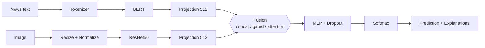

<div align="center">

# FakeShield AI

### Multimodal Fake News Detection | Deep Learning | Explainable AI

**When the text says one thing and the image says another, FakeShield AI notices.**

<p>
  
  
  
  
  
  
  
  
</p>

[Overview](#overview) | [Architecture](#architecture) | [Quick start](#quick-start) | [Experiments](#experiments) | [Explainability](#explainable-ai) | [Roadmap](#roadmap) | [Ethics](#limitations-and-ethics)

<!-- Add a GIF of the Streamlit app here:  -->

</div>

---

## Overview

Most fake news detectors read **text only**. But misinformation often hides in the *relationship* between a claim and its picture: a real photo from another event, a doctored image, a misleading caption.

**FakeShield AI** is a research prototype that fuses two deep encoders and studies whether combining them beats each modality alone.

| Text branch | Vision branch | Fusion |
|---|---|---|
| BERT contextual embeddings | ResNet50 visual features | Concatenation, Gated, Attention |

It comes with a **full experimental protocol**, **explainability tools**, and an **interactive Streamlit dashboard**.

> [!IMPORTANT]
> FakeShield AI is an experimental research prototype. It does **not** determine whether a claim is true or false. Its outputs reflect patterns learned from a dataset, not verified facts.

## Highlights

- **Unimodal baselines and multimodal fusion** in a single, clean PyTorch class
- **Three fusion strategies** to compare: concatenation, gated, cross-modal attention
- **Explainability built in:** Integrated Gradients (text), Grad-CAM (image), modality ablation
- **Reproducible evaluation:** Accuracy, Precision, Recall, Macro-F1, ROC-AUC, confusion matrix, inference time, model size
- **Streamlit app:** upload an image, paste a headline, see the prediction and the reasons behind it
- Mixed-precision training, layer-wise learning rates, automatic best-checkpoint saving

## Architecture



## Datasets

| Dataset | Role |
|---|---|
| [Fakeddit](https://github.com/entitize/Fakeddit) | Main training and evaluation dataset |
| [NewsCLIPpings](https://github.com/ICTMCG/NewsCLIPpings) | Cross-modal and out-of-context evaluation |
| [VisualNews](https://github.com/FuxiaoLiu/VisualNews) | Optional resource |

Check each dataset's license and terms of use before use. See [`data/README.md`](data/README.md).

## Quick start

```bash
# 1. Clone
git clone https://github.com/YOUR_USERNAME/FakeShield-AI.git
cd FakeShield-AI

# 2. Environment
python -m venv .venv
source .venv/bin/activate        # Windows: .venv\Scripts\activate
pip install -r requirements.txt

# 3. Data (Fakeddit TSV files in data/raw/, then fetch images)
python scripts/download_images.py --tsv data/raw/multimodal_train.tsv --limit 20000
python scripts/download_images.py --tsv data/raw/multimodal_validate.tsv --limit 3000
python scripts/download_images.py --tsv data/raw/multimodal_test_public.tsv --limit 3000

# 4. Train the experiments
python -m src.training.train --mode text
python -m src.training.train --mode image
python -m src.training.train --mode multimodal --fusion concat
python -m src.training.train --mode multimodal --fusion gated
python -m src.training.train --mode multimodal --fusion attention

# 5. Launch the app
streamlit run app/main.py
```

> **Tip:** No GPU? Add `--limit 2000 --epochs 1 --batch_size 16` to validate the pipeline, or train on Google Colab or Kaggle.

## Experiments

| # | Experiment | Command flag |
|---|---|---|
| 1 | Text-only (BERT) | `--mode text` |
| 2 | Image-only (ResNet50) | `--mode image` |
| 3 | Multimodal fusion | `--mode multimodal` |
| 4 | Fusion strategy comparison | `--fusion concat\|gated\|attention` |
| 5 | Explainability and error analysis | `src/explainability/explain.py` |
| 6 | Robustness and cross-dataset evaluation | NewsCLIPpings |

### Results

> Results are filled in **only after experiments are run** (JSON files in `reports/results/`). No numbers are assumed in advance.

| Model | Accuracy | Macro-F1 | ROC-AUC | ms/sample | Params |
|---|---|---|---|---|---|
| BERT (text) | - | - | - | - | - |
| ResNet50 (image) | - | - | - | - | - |
| BERT + ResNet50, concat | - | - | - | - | - |
| BERT + ResNet50, gated | - | - | - | - | - |
| BERT + ResNet50, attention | - | - | - | - | - |

## Explainable AI

| Modality | Method | Tool |
|---|---|---|
| Text | Integrated Gradients (token attribution) | Captum |
| Image | Grad-CAM heatmaps on ResNet `layer4` | PyTorch hooks |
| Multimodal | Modality ablation (full vs text-only vs image-only) | Built-in |

## Project structure

```text
FakeShield-AI/
├── app/main.py                  # Streamlit dashboard
├── src/
│   ├── data/                    # dataset.py, preprocessing.py
│   ├── models/                  # text_encoder, image_encoder, fusion, classifier
│   ├── training/train.py        # training loop (AMP, best checkpoint, test report)
│   ├── evaluation/metrics.py    # metrics and timing
│   └── explainability/explain.py
├── scripts/download_images.py
├── notebooks/                   # exploration and analysis
├── reports/{figures,results}/
├── tests/
└── requirements.txt
```

## Roadmap

- [x] Project architecture and code scaffold
- [ ] Dataset exploration (notebook 01)
- [ ] Text and image baselines
- [ ] Multimodal fusion experiments
- [ ] Explainability and error analysis
- [ ] Streamlit demo (GIF and deployment)
- [ ] CLIP-based representations
- [ ] Arabic and Moroccan Darija support
- [ ] Vision Transformers and uncertainty estimation

## Limitations and Ethics

Dataset bias, missing images, language and cultural bias, misleading text-image associations, domain shift and confidence miscalibration are all real risks. **Never use predictions as the sole basis for judging a person, organization or news source.** Always keep a human in the loop.

## References

- Nakamura et al., *r/Fakeddit: A New Multimodal Benchmark Dataset for Fine-grained Fake News Detection*, LREC 2020.
- Luo et al., *NewsCLIPpings: Automatic Generation of Out-of-Context Multimodal Media*, EMNLP 2021.
- Devlin et al., *BERT*, 2019. He et al., *Deep Residual Learning for Image Recognition*, 2016.
- Sundararajan et al., *Axiomatic Attribution for Deep Networks*, 2017. Selvaraju et al., *Grad-CAM*, 2017.

## Contributing

Issues and pull requests are welcome. Run `pytest` before submitting.

## Author

**CHAYMAE EL BAHLOUL**, Bachelor's student in Data Science

[GitHub](https://github.com/YOUR_USERNAME) | [LinkedIn](https://linkedin.com/in/YOUR_PROFILE)

## License

Released under the [MIT License](LICENSE).

<div align="center">

**From unimodal learning to multimodal intelligence.**

</div>
