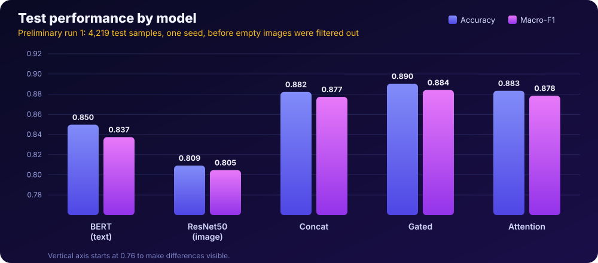
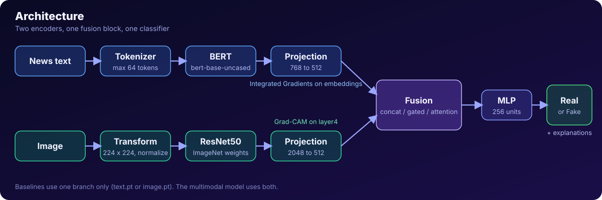
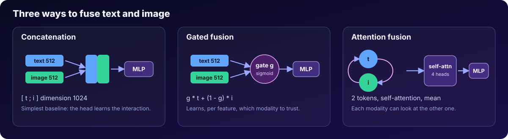
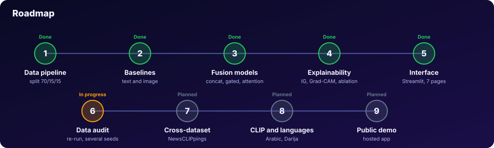

<div align="center">


<p>
  
  
  
  
  
  <a href="https://github.com/Chaymae-El-Bahloul/FakeShield-AI/actions/workflows/ci.yml"></a>
</p>

[Why](#why-fakeshield-ai)  ·  [Status](#current-status)  ·  [Demo](#demo)  ·  [Results](#results)  ·  [Architecture](#architecture)  ·  [Try it](#try-it)  ·  [Explainability](#explainable-ai)  ·  [Data quality](#data-quality-note)  ·  [Roadmap](#roadmap)

</div>

---

> **Project status: research prototype.** Every component below is marked *Done*, *In progress* or *Planned*. Numbers are labelled *preliminary* until they are reproduced after the data audit, and no result appears here that was not measured.

---

## At a glance

|          |                                                                                                              |
| -------- | ------------------------------------------------------------------------------------------------------------ |
| **What** | A multimodal fake news classifier that reads a news text **and** its image                                   |
| **How**  | BERT and ResNet50 encoders, three fusion strategies, a stratified and seeded evaluation protocol             |
| **Why**  | To measure whether combining text and image really beats each modality alone, and to see *why* the model decides what it decides |
| **Not**  | A fact-checker. It reports patterns learned from a dataset, never the truth of a claim                       |

---

## Why FakeShield AI?

A headline can be perfectly worded and still mislead, because the photo next to it comes from another event. A photo can be genuine and still mislead, because the caption lies about it. Detectors that read only one of the two miss this by design.

| Problem                           | Why it matters                                                            | What FakeShield AI does                                    |
| --------------------------------- | ------------------------------------------------------------------------- | ---------------------------------------------------------- |
| Text-only detectors               | Blind to out-of-context or edited images                                  | Adds a vision branch and fuses it with the text            |
| Image-only detectors              | Cannot read the claim attached to the picture                             | Compares image-only, text-only and fused models, same data |
| Black-box predictions             | A score without a reason is hard to trust                                 | Word attribution, Grad-CAM and modality ablation           |
| Unreproducible results            | "It works on my run" is not a result                                      | Fixed split, fixed seeds, results saved as JSON            |
| Silent data problems              | Broken inputs can leak the label and inflate scores                       | A data audit and a loader that rejects empty images        |

---

## Current status

| Component                     | Status      | Notes                                                                                   |
| ----------------------------- | ----------- | --------------------------------------------------------------------------------------- |
| Data pipeline                 | Done        | Fakeddit loader, text cleaning, image transforms, stratified 70/15/15 split             |
| Text and image baselines      | Done        | BERT only, ResNet50 only                                                                |
| Fusion models                 | Done        | Concatenation, gated, attention                                                         |
| Evaluation                    | Done        | Accuracy, precision, recall, macro-F1, ROC-AUC, confusion matrix                        |
| Explainability                | Done        | Integrated Gradients, Grad-CAM, modality ablation                                       |
| Streamlit interface           | Done        | Seven pages, dark and light themes                                                      |
| Automated tests and CI        | Done        | Fusion shape tests, interface smoke tests, GitHub Actions on Python 3.10 and 3.12       |
| Empty-image filtering         | Done        | Files under 512 bytes are ignored by the loader                                         |
| Results on the filtered data  | In progress | The table below is the first run; all five experiments are being re-run with several seeds |
| Cross-dataset evaluation      | Planned     | NewsCLIPpings                                                                           |
| CLIP, Arabic and Darija       | Planned     | See the [roadmap](#roadmap)                                                             |
| Public hosted demo            | Planned     | Needs hosted weights                                                                    |

---

## Demo

<div align="center">

</div>

Each analysis returns a verdict, a confidence score, a text-image consistency check and three tabs: **Analysis**, **Explanation** (influential words) and **Visual Insights** (Grad-CAM).

| Page                  | What it does                                                                |
| --------------------- | --------------------------------------------------------------------------- |
| Home                  | Overview and a quick analysis panel                                         |
| Text Analysis         | Text-only prediction with word attribution                                  |
| Image Analysis        | Image-only prediction with Grad-CAM                                         |
| Multimodal Prediction | Text and image together, with a choice of fusion model                      |
| Explainability        | Modality ablation, Grad-CAM and token attribution of the last analysis      |
| Model Benchmark       | Test results, confusion matrices and ROC curves of every trained model      |
| About                 | Method, data, limitations                                                   |

---

## Results

Test set: **4,219** held-out posts (15% of the 28,124 Fakeddit samples that have an image). Binary task, real versus fake.

<div align="center">

</div>

| Model                         | Accuracy   | Macro-F1   | ROC-AUC    |
| ----------------------------- | ---------- | ---------- | ---------- |
| BERT, text only               | 0.8497     | 0.8374     | 0.9239     |
| ResNet50, image only          | 0.8092     | 0.8047     | 0.8730     |
| BERT + ResNet50, concat       | 0.8822     | 0.8773     | 0.9512     |
| BERT + ResNet50, **gated**    | **0.8903** | **0.8841** | **0.9571** |
| BERT + ResNet50, attention    | 0.8834     | 0.8784     | 0.9480     |

**How to read it**

- Combining text and image beats both baselines: about 4 to 5 macro-F1 points over text alone and 7 to 8 over image alone.
- The three fusion strategies are within about one point of each other. With one seed on 4,219 test samples, that gap is **not enough to say that one fusion is better**.
- Inference times are not reported: they were measured with data loading included and are not a fair latency benchmark.

> [!NOTE]
> These are **preliminary results (run 1)**, obtained before empty image files were filtered out. See the [data quality note](#data-quality-note). They will be replaced by the re-run results, with the mean and standard deviation over several seeds.

---

## Architecture

<div align="center">

</div>

| Stage            | Responsibility                                                                    |
| ---------------- | --------------------------------------------------------------------------------- |
| Text branch      | Tokenize (64 tokens), BERT, take the [CLS] vector, project to 512 dimensions      |
| Vision branch    | Resize to 224, normalize, ResNet50, project 2048 features to 512 dimensions       |
| Fusion           | Combine the two 512-d embeddings (three strategies below)                         |
| Head             | MLP with 256 units and dropout, softmax over two classes                          |
| Explanations     | Integrated Gradients on BERT embeddings, Grad-CAM on ResNet `layer4`             |

### Three ways to fuse text and image

<div align="center">

</div>

The whole family is one class (`src/models/classifier.py`), so the baselines and the fusion models are trained and evaluated by exactly the same code:

```python
class FakeShieldModel(nn.Module):
    """mode: 'text' | 'image' | 'multimodal'  (baselines + fusion model in one class)."""

    def forward(self, input_ids=None, attention_mask=None, image=None, ablate=None):
        if self.mode == "text":
            return self.head(self.text_encoder(input_ids, attention_mask))
        if self.mode == "image":
            return self.head(self.image_encoder(image))
        t = self.text_encoder(input_ids, attention_mask)
        i = self.image_encoder(image)
        if ablate == "text":
            t = torch.zeros_like(t)
        elif ablate == "image":
            i = torch.zeros_like(i)
        return self.head(self.fusion(t, i))
```

---

## Explainable AI

| Modality   | Method                                              | Tool          |
| ---------- | --------------------------------------------------- | ------------- |
| Text       | Integrated Gradients (token attribution)            | Captum        |
| Image      | Grad-CAM heatmaps on ResNet50 `layer4`              | PyTorch hooks |
| Multimodal | Modality ablation: full versus text only versus image only | built in |

The ablation also drives the **text-image consistency** check in the interface: when the text-only and image-only views disagree, consistency is reported as low.

---

## Dataset and protocol

[Fakeddit](https://github.com/entitize/Fakeddit) (Nakamura et al., LREC 2020), multimodal subset, binary label `2_way_label` (1 = real, 0 = fake).

- Only posts whose image file is available **and non-empty** are kept.
- Stratified **70 / 15 / 15** split (train, validation, test) with `split_seed = 42`.
- The best epoch is selected on validation macro-F1. The test set is used once, at the end.
- Training: AdamW, learning rate 2e-5 for the encoders and 1e-3 for the head, 3 epochs, batch size 32, mixed precision.

---

## Try it

**Requirements:** Python 3.10 or newer. A GPU is recommended for training, not for the interface.

```bash
git clone https://github.com/Chaymae-El-Bahloul/FakeShield-AI.git
cd FakeShield-AI
python -m venv .venv
source .venv/bin/activate          # Windows: .venv\Scripts\activate
pip install -r requirements.txt
python -m pytest -q                # fusion and interface tests
```

**Run the interface.** It opens even without a checkpoint and tells you what is missing:

```bash
streamlit run app/main.py
```

Download `multimodal_gated.pt` (and optionally `text.pt`, `image.pt`) from the [Releases](https://github.com/Chaymae-El-Bahloul/FakeShield-AI/releases) page and put them in `models/`. Text-only and image-only pages use the dedicated model when present and otherwise a view of the multimodal model with the other modality switched off.

**Train.** The full protocol runs on a free Kaggle T4 GPU in [`notebooks/kaggle_training.ipynb`](notebooks/kaggle_training.ipynb). Locally, with the Fakeddit TSV and its images (see [`data/README.md`](data/README.md)):

```bash
python -m src.training.train --single_tsv data/raw/multimodal_train.tsv --image_dir data/raw/images --mode text
python -m src.training.train --single_tsv data/raw/multimodal_train.tsv --image_dir data/raw/images --mode image
python -m src.training.train --single_tsv data/raw/multimodal_train.tsv --image_dir data/raw/images --mode multimodal --fusion gated
```

Optional: put an illustration in `app/assets/hero.png` to replace the built-in one on the home page.

---

## Data quality note

While testing the interface, a sample of the evaluation images contained **empty (0 byte) image files**: posts whose original picture was no longer available. The loader now ignores any image file under 512 bytes (`MIN_IMAGE_BYTES` in `src/data/dataset.py`).

The notebook has an audit cell that counts empty files and checks whether they are concentrated in one class. If they were, a model could learn "blank image means fake" instead of looking at the picture, and image-based scores would be inflated. That is why the results above are labelled preliminary and are being recomputed on the filtered data.

---

## Engineering standards

| Area             | Tooling                                                           | Status      |
| ---------------- | ----------------------------------------------------------------- | ----------- |
| Language         | Python 3.10+, PyTorch 2.x                                         | Done        |
| Tests            | pytest: fusion shape tests, interface smoke tests (Streamlit `AppTest`) | Done   |
| CI               | GitHub Actions, Python 3.10 and 3.12, CPU PyTorch                 | Done        |
| Reproducibility  | Fixed split seed, training seed option, results saved as JSON     | Done        |
| Training         | Mixed precision, layer-wise learning rates, best-checkpoint saving | Done       |
| Formatting       | ruff                                                              | Planned     |
| Type checking    | mypy                                                              | Planned     |

### Design principles

1. **Measure before you claim.** Every number comes from a saved run.
2. **Same code for every model.** Baselines and fusion models share one class and one training loop.
3. **Explain, do not just predict.** Each verdict comes with the evidence behind it.
4. **Fail loudly on bad data.** Empty or unreadable inputs are surfaced, not silently replaced.
5. **Decisions are documented.** Limitations are written next to the results, not hidden.

---

## Project structure

```text
FakeShield-AI/
├── app/                         # Streamlit interface (theme, engine, pages)
├── assets/                      # README visuals
├── src/
│   ├── data/                    # dataset with stratified split, preprocessing
│   ├── models/                  # text and image encoders, fusion, classifier
│   ├── training/train.py        # training loop (AMP, seeds, best checkpoint)
│   ├── evaluation/metrics.py    # accuracy, F1, ROC-AUC, confusion matrix
│   └── explainability/explain.py
├── scripts/                     # image downloader
├── notebooks/                   # Kaggle training notebook
├── reports/{figures,results}/
├── tests/                       # fusion and interface tests
├── .github/workflows/ci.yml
├── .streamlit/config.toml
├── CONTRIBUTING.md
└── requirements.txt
```

---

## What FakeShield AI is, and is not

| It is                                                         | It is not                                              |
| ------------------------------------------------------------- | ------------------------------------------------------ |
| A reproducible comparison of text, image and fused models     | A fact-checking service                                |
| A study of fusion strategies with explanations                | A system validated on real news articles               |
| An interactive demo of what the models learned                | A production moderation tool                           |
| Honest about preliminary numbers and data issues              | A claim of state-of-the-art accuracy                   |

---

## Roadmap

<div align="center">

</div>

---

## Limitations and ethics

- Trained on English Reddit posts. It is not validated on news articles, other platforms, other languages (Arabic, Darija, French) or other topics.
- Labels reflect the dataset's own annotation scheme, not a journalist's fact-check.
- Dataset bias, removed images and confidence miscalibration are real risks.
- Never use a prediction as the sole basis for judging a person, an organization or a news source. Keep a human in the loop.

## References

- Nakamura et al., *r/Fakeddit: A New Multimodal Benchmark Dataset for Fine-grained Fake News Detection*, LREC 2020.
- Luo et al., *NewsCLIPpings: Automatic Generation of Out-of-Context Multimodal Media*, EMNLP 2021.
- Devlin et al., *BERT: Pre-training of Deep Bidirectional Transformers*, 2019.
- He et al., *Deep Residual Learning for Image Recognition*, 2016.
- Sundararajan et al., *Axiomatic Attribution for Deep Networks*, 2017.
- Selvaraju et al., *Grad-CAM: Visual Explanations from Deep Networks*, 2017.

## Contributing

Issues, ideas and feedback on the experimental protocol are welcome. See [CONTRIBUTING.md](CONTRIBUTING.md).

## Author

**Chaymae El Bahloul**, Bachelor's student in Data Science. Interests: deep learning, NLP, computer vision, multimodal machine learning. [GitHub](https://github.com/Chaymae-El-Bahloul)

## License

Released under the [MIT License](LICENSE).

---

<div align="center">

**Built to find out whether looking at the picture really helps.**
Star the repo to follow the results as the experiments are re-run.

</div>
