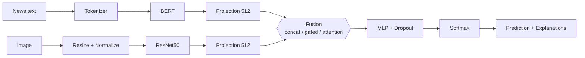

<div align="center">

# FakeShield AI

### Multimodal fake news detection with deep learning and explainable AI

**When the text says one thing and the picture says another, FakeShield AI notices.**

<p>
  
  
  
  
  
  
  
  
</p>

[Overview](#overview) | [Demo](#demo) | [Results](#results) | [Architecture](#architecture) | [Quick start](#quick-start) | [Explainability](#explainable-ai) | [Data quality](#data-quality-note) | [Ethics](#limitations-and-ethics)


</div>

---

## Overview

Most fake news detectors read **text only**. Yet misinformation often hides in the *relationship* between a claim and its picture: a real photo from another event, an edited image, a misleading caption.

FakeShield AI is a research project that trains and compares three kinds of models on the same data:

| Branch | Encoder | What it captures |
|---|---|---|
| Text | BERT (`bert-base-uncased`) | wording, style, context |
| Vision | ResNet50 (ImageNet) | visual content |
| Multimodal | BERT + ResNet50 + fusion | both, and how they relate |

Three fusion strategies are implemented and compared: **concatenation**, **gated fusion** and **cross-modal attention**. Everything is explained after the fact with Integrated Gradients (words), Grad-CAM (image regions) and modality ablation.

> [!IMPORTANT]
> FakeShield AI is an experimental research prototype. It does **not** establish whether a claim is true or false. Its outputs reflect patterns learned from a dataset of Reddit posts, not verified facts.

## Highlights

- One clean PyTorch class for the text baseline, the image baseline and the three fusion models
- Reproducible protocol: stratified 70/15/15 split, fixed seeds, results saved as JSON
- Metrics beyond accuracy: macro-F1, ROC-AUC, confusion matrix, model size
- Explainability built in: token attribution, Grad-CAM, modality ablation
- A complete **Streamlit interface** with seven pages, dark and light themes
- Mixed-precision training, layer-wise learning rates, automatic best-checkpoint saving

## Demo

The interface has seven pages:

| Page | What it does |
|---|---|
| Home | Overview and a quick analysis panel |
| Text Analysis | Text-only prediction with word attribution |
| Image Analysis | Image-only prediction with Grad-CAM |
| Multimodal Prediction | Text + image with a choice of fusion model |
| Explainability | Modality ablation, Grad-CAM and token attribution of the last analysis |
| Model Benchmark | Test results, confusion matrices and ROC curves of every trained model |
| About | Method, data, limitations |

Each result shows a verdict, a confidence score, a text-image consistency check and three tabs: **Analysis**, **Explanation** and **Visual Insights**.

## Results

Test set: **4,219** held-out posts (15% of 28,124 Fakeddit samples that have an image). Binary task: real vs fake.

| Model | Accuracy | Macro-F1 | ROC-AUC |
|---|---|---|---|
| BERT (text only) | 0.8497 | 0.8374 | 0.9239 |
| ResNet50 (image only) | 0.8092 | 0.8047 | 0.8730 |
| BERT + ResNet50, concat | 0.8822 | 0.8773 | 0.9512 |
| BERT + ResNet50, **gated** | **0.8903** | **0.8841** | **0.9571** |
| BERT + ResNet50, attention | 0.8834 | 0.8784 | 0.9480 |

**Reading the table**

- Combining text and image beats both single-modality baselines by roughly 4 to 5 macro-F1 points over text and 7 to 8 over image.
- The three fusion strategies are within about one point of each other. With one run and one seed on 4,219 test samples, this gap is not enough to claim that one fusion is better.
- Inference times are not reported: they were measured with data loading included and are not a fair latency benchmark.

> [!NOTE]
> These are **preliminary results (run 1)**, obtained before empty image files were filtered out (see [Data quality note](#data-quality-note)). The numbers will be recomputed on the filtered dataset and with several seeds.

<!-- Add after re-running the notebook:


-->

## Architecture



- **Concat:** the two 512-d embeddings are concatenated.
- **Gated:** a learned gate decides, per feature, how much to trust the text or the image.
- **Attention:** the two embeddings form a 2-token sequence processed by self-attention.

## Dataset and protocol

[Fakeddit](https://github.com/entitize/Fakeddit) (Nakamura et al., LREC 2020), multimodal subset, binary label `2_way_label` (1 = real, 0 = fake).

- Only posts whose image file is available **and non-empty** are kept.
- Stratified **70 / 15 / 15** split (train / validation / test), `split_seed = 42`.
- The best epoch is chosen on validation macro-F1; the test set is used once, at the end.
- Training: AdamW, lr 2e-5 for the encoders and 1e-3 for the head, 3 epochs, batch size 32, mixed precision.

## Quick start

```bash
# 1. Clone and install
git clone https://github.com/Chaymae-El-Bahloul/FakeShield-AI.git
cd FakeShield-AI
python -m venv .venv
source .venv/bin/activate          # Windows: .venv\Scripts\activate
pip install -r requirements.txt

# 2. Train (needs the Fakeddit TSV file and its images, see data/README.md)
python -m src.training.train --single_tsv data/raw/multimodal_train.tsv --image_dir data/raw/images --mode text
python -m src.training.train --single_tsv data/raw/multimodal_train.tsv --image_dir data/raw/images --mode image
python -m src.training.train --single_tsv data/raw/multimodal_train.tsv --image_dir data/raw/images --mode multimodal --fusion gated

# 3. Launch the interface
streamlit run app/main.py
```

- A GPU is strongly recommended for training. [`notebooks/kaggle_training.ipynb`](notebooks/kaggle_training.ipynb) runs the whole protocol on a free Kaggle T4 GPU.
- The interface loads the checkpoints found in `models/` (`text.pt`, `image.pt`, `multimodal_*.pt`). Without a checkpoint it still opens and tells you what is missing.
- Pretrained weights are not stored in the repository. Download them from the [Releases](https://github.com/Chaymae-El-Bahloul/FakeShield-AI/releases) page and place them in `models/`.
- Optional: put an illustration in `app/assets/hero.png` to replace the built-in one on the home page.

## Explainable AI

| Modality | Method | Tool |
|---|---|---|
| Text | Integrated Gradients (token attribution) | Captum |
| Image | Grad-CAM heatmaps on ResNet50 `layer4` | PyTorch hooks |
| Multimodal | Modality ablation: full vs text only vs image only | built in |

## Project structure

```text
FakeShield-AI/
├── app/                         # Streamlit interface (theme, engine, pages)
├── src/
│   ├── data/                    # dataset with stratified split, preprocessing
│   ├── models/                  # text and image encoders, fusion, classifier
│   ├── training/train.py        # training loop (AMP, seeds, best checkpoint)
│   ├── evaluation/metrics.py    # accuracy, F1, ROC-AUC, confusion matrix
│   └── explainability/explain.py
├── scripts/download_images.py
├── notebooks/kaggle_training.ipynb
├── reports/{figures,results}/
├── tests/
└── requirements.txt
```

## Data quality note

While testing the interface, a sample of the evaluation images revealed **empty (0 byte) image files** in the images collection used for training, for example posts whose original picture had been removed. The loader now ignores any image file smaller than 512 bytes (`MIN_IMAGE_BYTES` in `src/data/dataset.py`).

The notebook contains an audit cell that counts empty files and checks whether they are concentrated in one class. If they were, a model could learn "blank image = fake" instead of looking at the picture, which would inflate image-based scores. For that reason the results above are labelled preliminary and are being recomputed on the filtered data.

## Limitations and ethics

- Trained on Reddit posts in English: it is not validated on news articles, other platforms, other languages (Arabic, Darija, French) or other topics.
- Labels reflect the dataset's own annotation scheme, not a fact-check by a journalist.
- Dataset bias, missing or removed images and confidence miscalibration are real risks.
- Never use a prediction as the sole basis for judging a person, an organization or a news source. Keep a human in the loop.

## Roadmap

- [x] Text, image and multimodal models with three fusion strategies
- [x] Explainability: Integrated Gradients, Grad-CAM, modality ablation
- [x] Streamlit interface with seven pages
- [ ] Recompute all results on the filtered dataset with several seeds
- [ ] Cross-dataset evaluation (NewsCLIPpings)
- [ ] CLIP-based representations
- [ ] Arabic and Moroccan Darija support
- [ ] Uncertainty estimation and calibration
- [ ] Public online demo

## References

- Nakamura et al., *r/Fakeddit: A New Multimodal Benchmark Dataset for Fine-grained Fake News Detection*, LREC 2020.
- Luo et al., *NewsCLIPpings: Automatic Generation of Out-of-Context Multimodal Media*, EMNLP 2021.
- Devlin et al., *BERT: Pre-training of Deep Bidirectional Transformers*, 2019.
- He et al., *Deep Residual Learning for Image Recognition*, 2016.
- Sundararajan et al., *Axiomatic Attribution for Deep Networks*, 2017.
- Selvaraju et al., *Grad-CAM: Visual Explanations from Deep Networks*, 2017.

## Author

**Chaymae El Bahloul**, Bachelor's student in Data Science.
Interests: deep learning, natural language processing, computer vision, multimodal machine learning.
[GitHub](https://github.com/Chaymae-El-Bahloul)

## License

Released under the [MIT License](LICENSE).

<div align="center">

**From unimodal learning to multimodal intelligence.**

</div>
